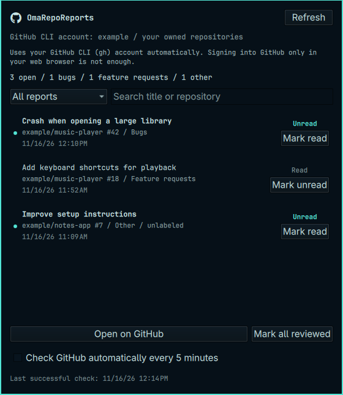

# OmaRepoReports

A theme-aware bar icon and popup for **all open issues in repositories owned by
the GitHub account authenticated with `gh`**, including private repositories
available to that account. Pull requests are excluded. Organization-owned and
collaborator repositories, Discussions, and off-GitHub feedback are not included.



*Preview uses demonstration reports.*

Requires Omarchy Quattro's Quickshell plugin API, Python 3, GNU `timeout`
(coreutils), and GitHub CLI (`gh`, the `github-cli` Arch package). Desktop alerts
use Omarchy's notification service. The plugin has no pip or npm dependencies.

## Install

```sh
omarchy plugin add https://github.com/kelmankenberg/OmaRepoReport.git --enable
```

The GitHub icon appears on the right side of the bar. Sign into GitHub CLI as
described below, then click the icon to view your reports.

## GitHub sign-in

**You must be signed into GitHub CLI (`gh`). Being signed into GitHub in a web
browser alone is not enough.** OmaRepoReports automatically uses the active
local GitHub CLI account; no username needs to be configured.

If GitHub CLI is not signed in, run this in a terminal:

```sh
gh auth login --hostname github.com
```

Then click **Refresh** in OmaRepoReports. If you already use `gh`, no additional
sign-in is needed. Use `gh auth status` to check your account. The popup displays
the account it is using. Sign-in guidance appears in Settings and in the main
view when no account has been loaded or a refresh fails.

## Use

- Left-click the GitHub icon for a summary, filters, repository/title search,
  and direct report links. Right-click opens the cross-repository GitHub search;
  middle-click refreshes.
- The badge counts open reports with unread activity, **not** total open reports.
  Existing reports start unread. Opening a report or selecting **Mark all
  reviewed** acknowledges its current update timestamp. Later comments or edits
  make it unread again. Acknowledgment is local; it does not change GitHub
  notification state or post anything.
- Each report has a **Mark read** / **Mark unread** button that changes its local
  status without opening the browser, plus an always-visible **Read** / **Unread**
  label. Unread reports also have a colored dot and bold title. The badge updates
  immediately, and manual unread status survives refreshes and shell restarts.
- The default refresh interval is five minutes. Use the gear icon to choose a
  different schedule or manual-only mode. Preferences survive shell restarts,
  and polling is shared across monitors. Unloading the last widget stops the
  polling timer, helper, and pending alerts.
- All labels are accepted; common `bug` and `enhancement` / `feature request`
  labels categorize reports. Everything else remains visible under Other.
- GitHub Search limits retrieval to 1,000 issues. The popup discloses truncation;
  total open count and the GitHub link still cover every owned repository.
  Closed reports disappear on refresh; activity on closed issues is not tracked.
- On errors, the previous results remain visible and an `!` badge indicates
  failure. The footer shows the last successful check.

No separate access token, webhook, GitHub Watch subscription, or system service
is needed. No issue bodies or credentials are stored. Issue titles, URLs,
timestamps, and local review state are saved privately under
`${XDG_STATE_HOME:-~/.local/state}/omarchy-github-reports/state.json`.

## Permissions and privacy

Like other Omarchy shell plugins, this runs unsandboxed as your desktop user.
Only install plugins whose source and behavior you trust.

- GitHub CLI handles authentication. The plugin does not read or store tokens
  itself; it uses your existing account's access for read-only GitHub API calls
  to identify the account and retrieve open-issue metadata.
- Automatic checks contact `api.github.com` every five minutes by default.
  Settings offers manual-only mode and intervals up to two hours. Refresh is
  always user-accessible. No analytics, telemetry, or third-party API is used.
- The cache includes private issue titles, repository names, URLs, timestamps,
  preferences, and local read history. The state file is owner-readable/writable
  only; the plugin does not encrypt them. Cached reports remain available while
  offline or signed out. A successful account switch replaces the reports and
  clears the previous account's read history.
- Read/unread actions modify only that local cache. The plugin does not create,
  edit, or close GitHub issues, or change GitHub notification state.
- Opening reports, the repository, or feedback forms launches your browser.
  Feedback is submitted only if you complete the GitHub form yourself.
  Optional desktop alerts contain counts only, never issue titles.
- Installation needs no elevated privileges, background system service, or
  changes to configuration outside Omarchy's normal plugin enablement.

## Settings

Click the **gear icon** beside Refresh to open Settings; use **Back** to return
to your reports.

- **Refresh schedule:** manual-only, 5, 10, 15, or 30 minutes, or 1 or 2 hours.
  Changes take effect immediately; the footer shows the selected schedule.
  **Refresh** always checks immediately, even in manual-only mode.
- **Notifications:** the unread badge is enabled by default. Optional desktop
  alerts are disabled by default and report counts only, never issue titles.
  After the first successful check, new or updated open reports can trigger
  alerts; marking a report unread does not. Click an alert to open the plugin.
  Error indicators remain visible even if the unread badge is disabled.
- **GitHub account:** see the last successfully checked CLI account. Expand
  **Sign-in help** for instructions (shown automatically before an account is
  loaded). Click Refresh to check the current account again.
- **Plugin feedback:** report bugs, request features, open the repository, and
  see the installed plugin version.

Existing read/unread history and paused refresh preferences are preserved when
upgrading.

## Report a bug or suggest a feature

Use **Report bug** or **Request feature** under **Plugin feedback** in
**Settings** to open the matching GitHub issue form. These actions submit feedback about
**OmaRepoReports itself**, not the repositories you are monitoring.

You can also open a [bug report](https://github.com/kelmankenberg/OmaRepoReport/issues/new?template=bug_report.yml)
or [feature request](https://github.com/kelmankenberg/OmaRepoReport/issues/new?template=feature_request.yml)
directly. Sign into GitHub in your browser to submit the form; the plugin does
not post issues automatically. Never include tokens, credentials, or private
repository details in a public report.

## Remove

```sh
omarchy plugin remove kel.github-reports
```

Confirm removal when prompted. This removes the plugin and stops its checks.
Your GitHub account and repositories are not changed. The private cache and
preferences are retained in
`${XDG_STATE_HOME:-~/.local/state}/omarchy-github-reports/`; delete that directory
separately if you no longer want the saved reports and read history.

## Local installation

Copy this folder (not a symlink) to
`~/.config/omarchy/plugins/kel.github-reports`, then run:

```sh
omarchy plugin validate ~/.config/omarchy/plugins/kel.github-reports
omarchy plugin enable kel.github-reports --section right
```

Only the installed copy is live; copy changed source files there after editing.
If the shell still displays old controls after a plugin reload, run
`omarchy restart shell` to clear the running shell's cached QML.

```sh
python3 -m unittest discover -s tests -v
omarchy-shell kel.github-reports status
```

## License

MIT. See [LICENSE](LICENSE). Runtime dependencies retain their own licenses.
